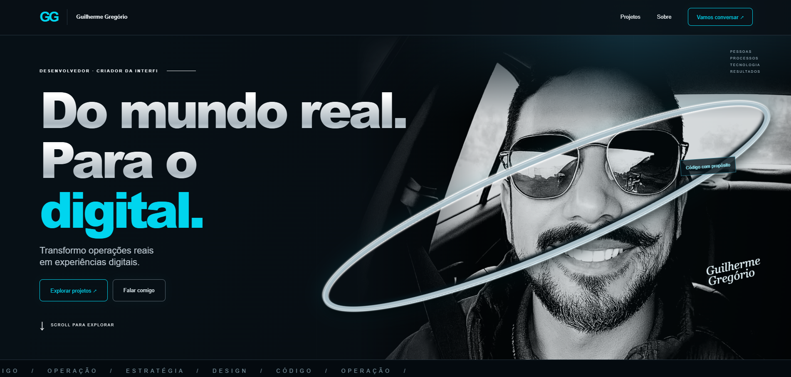
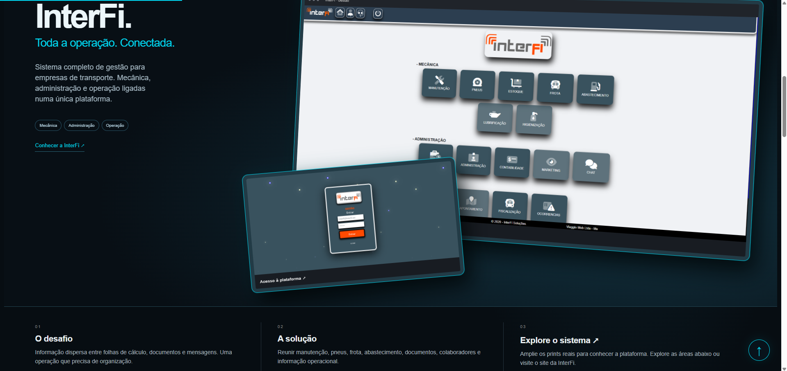
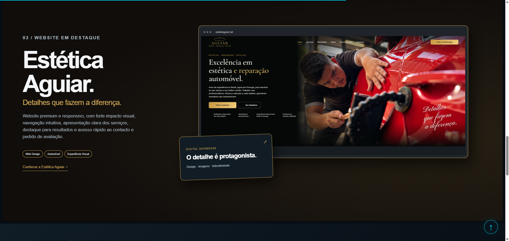
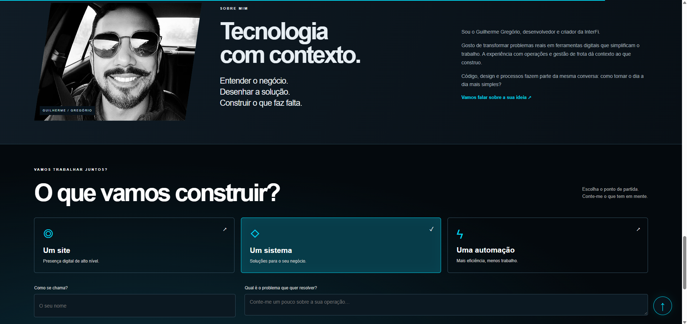
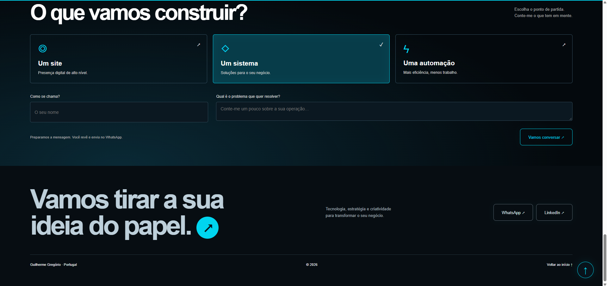

# Guilherme Gregório — Portfólio

**Do mundo real. Para o digital.**

Portfólio pessoal voltado à apresentação de projetos, trajetória profissional e desenvolvimento de soluções digitais.

A proposta conecta experiência em operações e gestão à criação de websites, sistemas e automações, com uma interface visual e interativa.

🌐 **Site:** https://www.guilhermegregorio.com/
📦 **Repositório:** https://github.com/djgregui/Guilherme-Site

## Visão geral

O site reúne:

- Apresentação pessoal e posicionamento profissional.
- Cases da InterFi, AVV Travel e Estética Aguiar.
- Capturas dos projetos com visualização ampliada.
- Seção sobre experiência e abordagem de trabalho.
- Formulário de briefing com encaminhamento para WhatsApp.
- Acesso ao perfil profissional no LinkedIn.

## Prévia do site

 

 

 

 

 

## Tecnologias

| Tecnologia | Aplicação |
|---|---|
| **HTML5** | Estrutura semântica, formulários e diálogos nativos |
| **CSS3** | Layout responsivo, animações e efeitos de profundidade |
| **JavaScript** | Interações, validação e atualização dinâmica da interface |
| **APIs nativas do navegador** | IntersectionObserver, requestAnimationFrame e matchMedia |

O projeto utiliza HTML, CSS e JavaScript diretamente, sem frameworks de interface, instalação de pacotes ou etapa de compilação.

## Funcionalidades e decisões técnicas

### Apresentação visual dos projetos

Os cases combinam textos, capturas reais e links para os respectivos sites.

As imagens são apresentadas em composições com molduras de navegador, sobreposições e transformações CSS para criar profundidade visual.

### Ampliação de imagens

As capturas podem ser abertas em um modal usando o elemento nativo `<dialog>` e o método `showModal()`.

O conteúdo é definido por atributos `data-image` e `data-caption`, permitindo reutilizar a mesma interface para diferentes imagens.

O modal oferece botão de fechamento, suporte à tecla Escape e fechamento ao clicar fora da área da janela.

### Animações durante a rolagem

O `IntersectionObserver` identifica quando os elementos entram na área visível e aplica as animações de entrada.

Depois de revelar cada elemento, o código deixa de observá-lo. O conteúdo permanece visível quando esse recurso não está disponível.

### Indicador de progresso de leitura

Uma barra acompanha o avanço da rolagem pela página.

A atualização usa `requestAnimationFrame` e controle de agendamento para evitar atualizações repetidas dentro do mesmo quadro de renderização.

### Movimento do retrato

O retrato da seção inicial responde à posição do ponteiro por meio de variáveis CSS atualizadas pelo JavaScript.

Esse efeito é condicionado à presença de um ponteiro preciso e à preferência do visitante por animações.

### Briefing integrado ao WhatsApp

O visitante seleciona o tipo de projeto:

- Website.
- Sistema.
- Automação.

A interface adapta a pergunta ao serviço escolhido e reúne nome, tipo de projeto e descrição em uma mensagem.

O texto é codificado com `encodeURIComponent` e encaminhado para um link `wa.me`. O visitante revisa e confirma o envio no WhatsApp.

Não há backend próprio para receber ou armazenar esse formulário.

### Validação do formulário

A implementação combina:

- Campos obrigatórios com `required`.
- Limites de tamanho com `maxlength`.
- Remoção de espaços nas extremidades com `trim()`.
- Mensagens de validação com `setCustomValidity()`.
- Exibição dos avisos com `reportValidity()`.

### Navegação e retorno ao topo

A página utiliza links internos para acessar projetos, apresentação e contato.

Um botão de retorno ao topo aparece após o visitante percorrer parte da página e adapta o comportamento de rolagem à preferência por movimento reduzido.

## Responsividade e acessibilidade

O código inclui:

- Layouts com CSS Grid e Flexbox.
- Media queries para adaptação a diferentes larguras.
- Indicadores de foco com `:focus-visible`.
- Rótulos acessíveis com `aria-label`.
- Estado dos botões de seleção com `aria-pressed`.
- Textos alternativos nas imagens.
- Tratamento de `prefers-reduced-motion` para reduzir efeitos.
- Elementos decorativos ocultos de tecnologias assistivas com `aria-hidden`.

Esses recursos fazem parte da implementação; não representam uma certificação de acessibilidade.

## Carregamento e organização

- JavaScript carregado com `defer`.
- Carregamento adiado de imagens selecionadas com `loading="lazy"`.
- Prioridade de carregamento no retrato principal com `fetchpriority="high"`.
- Eventos de rolagem com listeners passivos.
- Separação entre estrutura, apresentação e comportamento.
- Metadados de descrição e configuração de viewport no HTML.

## Estrutura do projeto

| Caminho | Responsabilidade |
|---|---|
| `index.html` | Estrutura, conteúdo e elementos da interface |
| `style.css` | Identidade visual, responsividade e animações |
| `script.js` | Interações, modais, formulário e rolagem |
| `assets/` | Retrato e capturas dos projetos |
| `README.md` | Apresentação e documentação do portfólio |

## Executar localmente

Por ser um projeto estático, basta abrir `index.html` em um navegador moderno.

Também pode ser servido por um servidor HTTP local ou hospedado em um serviço compatível com arquivos estáticos.

O funcionamento básico não exige PHP nem banco de dados.

## Personalização

- **Textos e cases:** editar `index.html`.
- **Cores, layouts e efeitos:** editar `style.css`.
- **Número do WhatsApp:** ajustar `CONFIG.whatsapp` em `script.js`.
- **Perguntas do briefing:** editar o objeto `prompts` em `script.js`.
- **Imagens:** substituir os arquivos em `assets/` e atualizar suas referências.

O número do WhatsApp deve usar o formato internacional, sem `+`, espaços ou pontuação.

## Responsável pelo projeto

**Guilherme Gregório**

Desenvolvimento web, sistemas e automações com foco em necessidades reais de negócio.